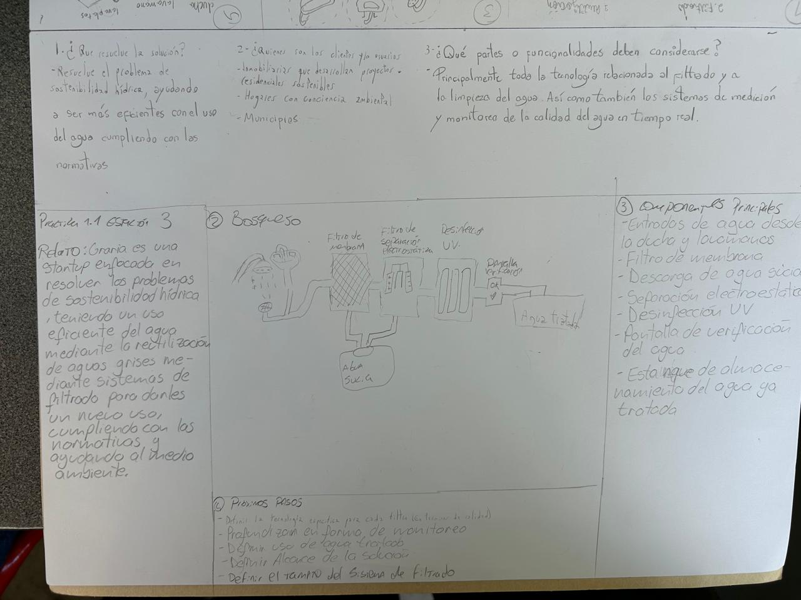
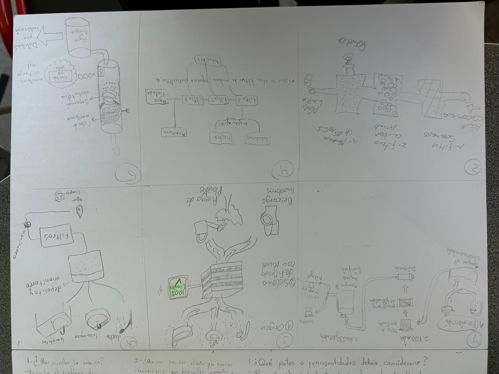

# Práctica 1.1 — Mapa de la solución con módulos

> Transcripción fiel del block. Fotos originales al final.

## 1. Práctica 1.1

### Estación 1

**1. ¿Qué resuelve la solución?**
Resuelve el problema de sostenibilidad hídrica, ayudando a ser más eficientes con el uso del agua cumpliendo con las normativas.

**2. ¿Quiénes son los clientes y/o usuarios?**
- Inmobiliarias que desarrollan proyectos residenciales sostenibles
- Hogares con conciencia ambiental
- Municipios

**3. ¿Qué partes o funcionalidades deben considerarse?**
Principalmente toda la tecnología relacionada al filtrado y a la limpieza del agua. Así como también los sistemas de medición y monitoreo de la calidad del agua en tiempo real.

### Estación 3

**Relato:** Graria es una startup enfocada en resolver los problemas de sostenibilidad hídrica, teniendo un uso eficiente del agua mediante la reutilización de aguas grises mediante sistemas de filtrado para darles un nuevo uso, cumpliendo con las normativas y ayudando al medio ambiente.

**② Bosquejo** (descripción del dibujo)
Flujo de izquierda a derecha: ducha y lavamanos → **Filtro de membrana** → **Filtro de separación electrostática** → **Desinfección UV** → **Pantalla de verificación** → **Agua tratada** (estanque). Desde los filtros baja una salida hacia un depósito de **Agua sucia**.

**③ Componentes principales**
- Entradas de agua desde la ducha y lavamanos
- Filtro de membrana
- Descarga de agua sucia
- Separación electroestática
- Desinfección UV
- Pantalla de verificación del agua
- Estanque de almacenamiento del agua ya tratada

**④ Próximos pasos**
- Definir la tecnología específica para cada filtro (en términos de calidad)
- Profundizar en forma de monitoreo
- Definir uso de agua tratada
- Definir alcance de la solución
- Definir el tamaño del sistema de filtrado

### Estación 2 — Bosquejos individuales (6 bocetos)

Hoja dividida en 6 recuadros numerados, cada uno con una propuesta de solución dibujada:

| N° | Contenido del boceto |
|---|---|
| 1 | Flujo en 3 etapas: **1. Recolección** (lavamanos/ducha) → **2. Filtrado** (filtro de partículas, monitoreo de filtración) → **3. Reutilización** (tanque de agua limpia, distribución). Incluye "Tanque de almacenamiento". `[parcialmente dudoso]` |
| 2 | **Agua contaminada** pasa por: **1.** Filtro de sedimentos → **2.** Filtro de carbón activado → **3.** Membrana de ósmosis → **Agua limpia**. Salida lateral de "Residuos". |
| 3 | **① Origen**: tres fuentes (lavamanos, ducha, etc.) → **② Sistema de filtrado con nivel** (bloque en capas con raíces, pantalla "100% limpio") → **Descarga de inodoros** y **Riego de plantas**. |
| 4 | Diagrama: **Agua grises** (lavaplatos, ducha, lavamanos) → Filtro 1, Filtro 2, Filtro 3 → **Agua tratada**; salida de **Desechos** y **Monitoreo**. Nota: "*Filtros: se utilizan filtros de membrana, separación electrostática, etc." |
| 5 | Lavaplatos, lavamanos y ducha → **depósito y monitoreo** → **Filtros** → monitoreo → **Agua limpia**. |
| 6 | Columna cilíndrica con **Filtro de membrana** y **Separación electrostática**; indicador "Calidad OK" y "monitoreo en tiempo real"; tanque **Agua limpia** → "Distribución para reutilización". |

## Fotos originales

