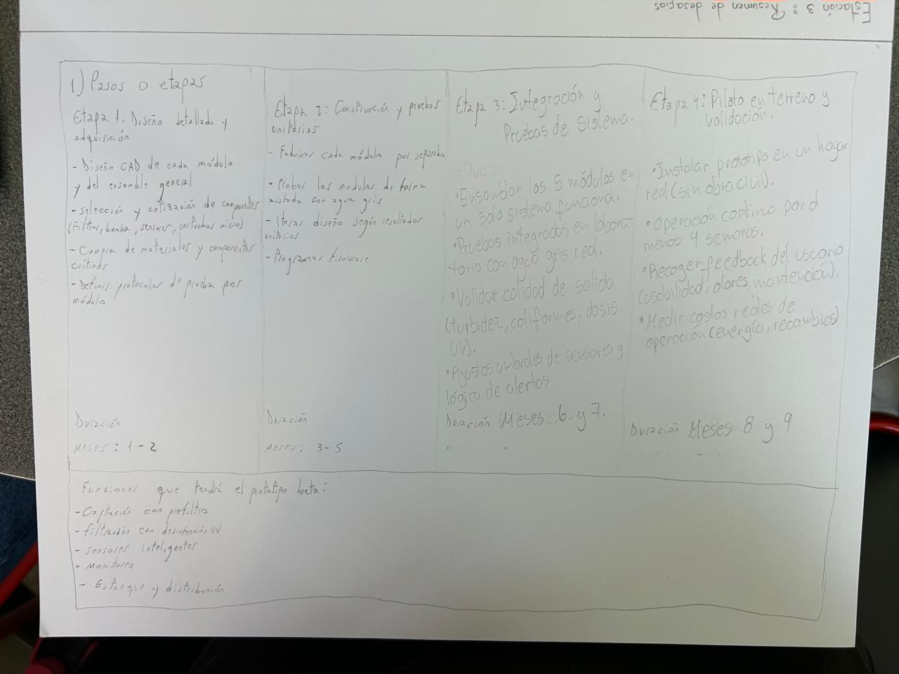

# Práctica 2.4 — Diseño del prototipo y costeo inicial

> Transcripción fiel del block (Estación 1) y resumen del Excel del grupo (Estación 2).

> **Desactualizada.** Esta práctica plantea venta B2C de un equipo por departamento. La entrevista del 26/10/2026, el DS 40 y el cálculo de ahorro lo descartaron. El diseño vigente está en [deck-2/01-iteracion-y-decisiones.md](../deck-2/01-iteracion-y-decisiones.md). Se mantiene sin cambios como registro de lo trabajado en clase.

## Estación 1 — Estructura del prototipo beta funcional

**1) Pasos o etapas**

| Etapa | Nombre | Actividades | Duración |
|---|---|---|---|
| 1 | Diseño detallado y adquisición | • Diseño CAD de cada módulo y del ensamble general • Selección y cotización de componentes (filtros, bomba, sensores, cartuchos micro) • Compra de materiales y componentes críticos • Definir protocolos de prueba por módulo | Meses 1–2 |
| 2 | Construcción y pruebas unitarias | • Fabricar cada módulo por separado • Probar los módulos de forma aislada con agua gris • Iterar diseño según resultados unitarios • Programar firmware | Meses 3–5 |
| 3 | Integración y pruebas de sistema | • Ensamblar los 5 módulos en un solo sistema funcional • Pruebas integradas en laboratorio con agua gris real • Validar calidad de salida (turbidez, coliformes, dosis UV) • Ajustar umbrales de sensores y lógica de alertas | Meses 6 y 7 |
| 4 | Piloto en terreno y validación | • Instalar prototipo en un hogar real (sin obra civil) • Operación continua por al menos 4 semanas • Recoger feedback del usuario (usabilidad, olores, mantención) • Medir costos reales de operación (energía, recambios) | Meses 8 y 9 |

**Funciones que tendrá el prototipo beta:**
- Captación con prefiltro
- Filtración con desinfección UV
- Sensores inteligentes
- Monitoreo
- Estanque y distribución

## Estación 2 — Estimación de costos (“Mis primeros 9 meses”)

Fuente: [Mis cuentas de emprendimiento Grupo 4 Graria.xlsx](../finanzas/mis-cuentas-ANTES-de-la-entrevista.xlsx) (hojas *Resumen del emprendimiento*, *Mis primeros 9 meses* y *Mi plan de crecimiento*). El detalle ítem por ítem (78 líneas con proveedor, enlace y supuesto) está en el Excel.

### Resumen del emprendimiento (hoja 1)

| Campo | Contenido |
|---|---|
| Mi emprendimiento | Graria |
| Qué es | Sistema compacto que recicla el agua gris de ducha y lavadora para el estanque del WC, sin obra civil. |
| Problema | Escasez hídrica: un hogar usa agua potable para el WC (cerca de un 25% de su consumo). |
| Solución | Prefiltro + microfiltración + desinfección UV, sensores con ESP32 y lectura en el celular vía QR + BLE. |
| Cliente | Hogares (B2C) y, desde el mes 25, constructoras. |
| Modelo de ingresos | Venta del equipo instalado (USD 320) + plan de mantención (USD 8/mes). |
| Inversión prototipo beta (meses 1-9) | USD 9.008 en total: USD 3.158 en materiales y servicios (6 equipos: prototipo + 5 réplicas, piloto en 5 hogares) + USD 5.850 en horas del equipo valorizadas (6 personas, $5.000/h). |
| Financiamiento | Semilla Inicia CORFO USD 15.000 (mes 13), aporte fundadores USD 5.000, inversionista ángel USD 20.000 (mes 25). |
| Flujo mensual positivo desde | Mes 37 |
| Equipos instalados al mes 48 | 1.134 |
| Caja acumulada al mes 48 | USD 57.664 |

### Egresos y flujo de caja, meses 1 a 9 (USD)

| Mes | 1 | 2 | 3 | 4 | 5 | 6 | 7 | 8 | 9 |
|---|---|---|---|---|---|---|---|---|---|
| Etapa | E1 | E1 | E2 | E2 | E2 | E3 | E3 | E4 | E4 |
| Egresos totales | 789,79 | 903,01 | 682,79 | 713,78 | 662,10 | 750,95 | 2.468,59 | 943,42 | 1.093,75 |
| Costos operacionales | 744,71 | 854,02 | 667,98 | 707,98 | 656,00 | 731,78 | 2.293,27 | 741,75 | 1.013,41 |
| Recursos humanos (valorizados) | 650 | 650 | 650 | 650 | 650 | 650 | 650 | 650 | 650 |
| Operaciones | 94,71 | 204,02 | 17,98 | 57,98 | 6,00 | 81,78 | 1.643,27 | 91,75 | 363,41 |
| Gastos (imprevistos 10 % incl.) | 45,08 | 48,99 | 14,81 | 5,80 | 6,10 | 19,18 | 175,33 | 201,67 | 80,34 |
| Flujo de caja | −789,79 | −903,01 | −682,79 | −713,78 | −662,10 | −750,95 | −2.468,59 | −943,42 | −1.093,75 |
| Flujo acumulado | −789,79 | −1.692,80 | −2.375,59 | −3.089,37 | −3.751,47 | −4.502,42 | −6.971,02 | −7.914,44 | −9.008,19 |

Recursos humanos: 6 personas, 130 h/mes en total a $5.000/h (= USD 650/mes), costo de oportunidad no pagado en efectivo. Roles: gestión del proyecto y finanzas (USD 100/mes), diseño mecánico e hidráulico (200), electrónica, firmware y app (200), validación con usuarios y laboratorio (150).

### Supuestos generales del Excel

1. Valores en USD (1 USD = 1.000 CLP). Precios cotizados en octubre de 2026, con IVA incluido salvo indicación.
2. Etapas: E1 Diseño y adquisición (meses 1-2), E2 Construcción y pruebas unitarias (3-5), E3 Integración y pruebas (6-7), E4 Piloto en terreno (8-9).
3. Recursos humanos valorizados: el equipo no recibe sueldo; sus horas se valorizan a $5.000/h ($900.000 al mes / 180 h, ingeniero junior en su primer año).
4. Diseño CAD, firmware del ESP32 y app QR + BLE con software gratuito o licencia educacional UdeC.
5. El ESP32 trae Bluetooth integrado, no se compra módulo BLE aparte.
6. Análisis de laboratorio según lista de precios de Agrolab (Santiago); confirmar si incluyen IVA.
7. Los ítems marcados “Estimado” o “Supuesto” no tienen cotización directa.
8. Imprevistos = 10 % de operaciones y gastos de cada mes (no se aplican a las horas del equipo).
9. No hay ingresos en los 9 meses: el flujo acumulado del mes 9 es la inversión total del prototipo beta.
10. Se fabrican 6 equipos: el prototipo original (meses 1-6) y 5 réplicas compradas en el mes 7. 5 van a hogares piloto distintos (uno por integrante) y 1 queda en laboratorio.

### Plan de crecimiento (hoja 3, extracto)

- Precio equipo instalado: USD 320. Plan de mantención: USD 8/mes.
- Ventas mensuales de equipos: 3 (mes 13) → 5 (mes 16) → 10 (mes 19) → 20 (mes 25) → 35 (mes 31) → 50 (mes 37) → 70 (mes 43).
- Clientes con mantención activa: 3 (mes 14) → 1.064 (mes 48).
- Financiamiento: CORFO USD 15.000 + fundadores USD 5.000 (mes 13); ángel USD 20.000 (mes 25). Series A y B en 0.
- Detalle completo mes a mes (hasta el mes 48) en el Excel.

## Fotos originales

